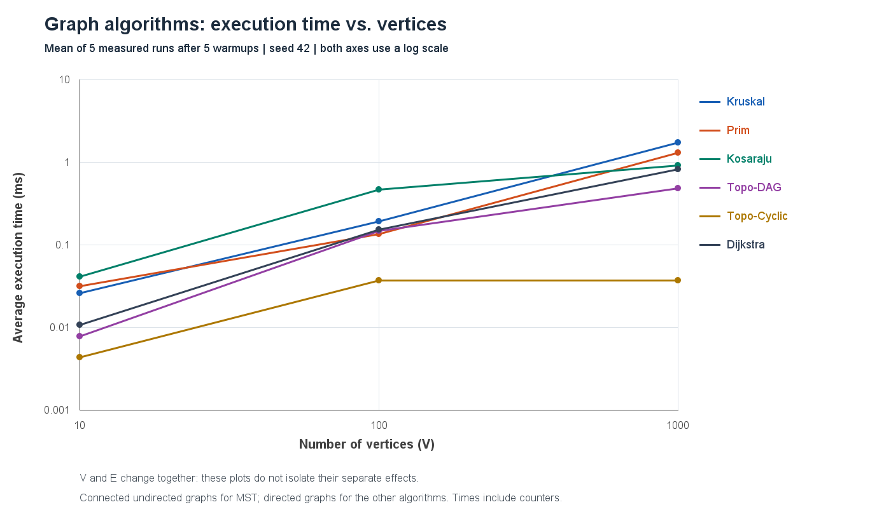
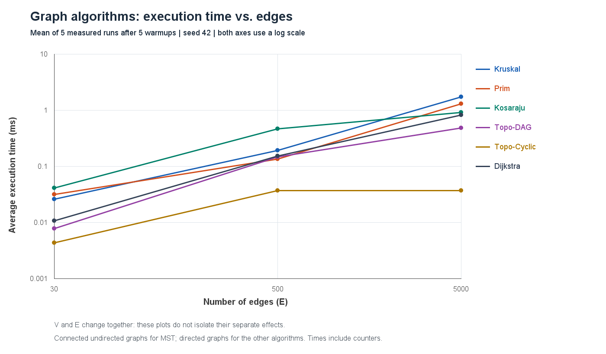

# Assignment 3 - Smart City Infrastructure and Route Planning

**Course:** Design and Analysis of Algorithms

**Student:** Aruzhan Amerkhanova

**Language:** Java, standard library only

**Repository:** [xelllion/Assignment3_DAA](https://github.com/xelllion/Assignment3_DAA)

## Overview

This application models a smart city as a weighted graph. Vertices are districts or locations. Edges represent roads, infrastructure connections, or service dependencies. Weights represent construction costs or travel distances, depending on the task.

It answers three questions:

1. **Infrastructure:** what is the cheapest network connecting all districts? Kruskal and Prim find a minimum spanning tree (MST).
2. **Connectivity:** which locations can reach each other using one-way roads? Kosaraju finds strongly connected components (SCCs). Kahn's algorithm orders dependencies when there is no directed cycle.
3. **Routes:** what are the shortest routes from a selected district? Dijkstra returns distances and actual paths.

### Graph representation

`Graph` stores an adjacency list and a list of logical edges. Vertices are numbered from `0` to `V - 1`. `Edge` contains `from`, `to`, and an integer `weight`.

An undirected edge appears once in the edge list and twice in adjacency lists, once per direction. Thus, E undirected edges have 2E adjacency entries. Directed edges have one adjacency entry. Graph storage is **O(V + E)**.

The graph class accepts parallel edges and self-loops for testing; the experiment generators exclude them. Graphs must have at least one vertex. Invalid vertex numbers are rejected. Total costs and distances use `long` to avoid overflowing when sums exceed the `int` range.

```text
Assignment3_DAA/
|-- src/
|   |-- graph/             Edge, Graph, GraphGenerator, Metrics
|   |-- dsu/               DisjointSet
|   |-- mst/               Kruskal, Prim, MstResult
|   |-- connectivity/      Kosaraju, TopologicalSort
|   |-- shortestpath/      Dijkstra
|   |-- Main.java
|   |-- AlgorithmTests.java
|   |-- BenchmarkRunner.java
|   |-- PlotGenerator.java
|   `-- ResultsChecks.java
|-- results/
|   |-- tables/            Raw runs, summaries, environment, graph hashes
|   `-- plots/             Two PNG charts
|-- .github/workflows/     Compilation and correctness checks
|-- .idea/                 Minimal shared IntelliJ configuration
|-- Assignment3_DAA.iml
|-- build.ps1
`-- README.md              Complete report and instructions
```

### Open and run in IntelliJ IDEA

1. Choose **File > Open** and select the `Assignment3_DAA` folder.
2. In **File > Project Structure > Project**, select your JDK. This project was tested with **OpenJDK 26**. If `openjdk-26` is missing, select your actual JDK installation.
3. Ensure `src` is marked as **Sources Root**. The supplied `.iml` already sets this.
4. Open `Main.java` and click the green Run button next to `main`.
5. Run `AlgorithmTests` for correctness, `BenchmarkRunner` for measurements, and `PlotGenerator` for charts.
6. Use the project folder as the run configuration's **Working directory**. Run `ResultsChecks` to validate the saved evidence.

There is no Maven, Gradle, graph library, or testing framework. The source uses Java 17-compatible language and APIs; IntelliJ's language level and command-line `--release 17` reflect this. Compilation and execution were checked with JDK 26.

### Command-line instructions

Open PowerShell **in the project directory**, replacing the JDK path if necessary:

```powershell
$env:JAVA_HOME = "$env:USERPROFILE\.jdks\openjdk-26"
.\build.ps1
& "$env:JAVA_HOME\bin\java.exe" -cp out Main
& "$env:JAVA_HOME\bin\java.exe" -cp out AlgorithmTests
& "$env:JAVA_HOME\bin\java.exe" -cp out ResultsChecks
```

To reproduce measurements and regenerate both plots:

```powershell
& "$env:JAVA_HOME\bin\java.exe" -cp out BenchmarkRunner
& "$env:JAVA_HOME\bin\java.exe" '-Djava.awt.headless=true' -cp out PlotGenerator
& "$env:JAVA_HOME\bin\java.exe" -cp out ResultsChecks
```

The benchmark replaces the default CSV files. The plot generator reads the new `summary.csv` and replaces the PNGs. Update this report's numerical tables and discussion if you publish new measurements. To keep submitted results unchanged, use alternative output folders:

```powershell
& "$env:JAVA_HOME\bin\java.exe" -cp out BenchmarkRunner out/recheck/tables
& "$env:JAVA_HOME\bin\java.exe" '-Djava.awt.headless=true' -cp out PlotGenerator out/recheck/tables/summary.csv out/recheck/plots
& "$env:JAVA_HOME\bin\java.exe" -cp out ResultsChecks out/recheck/tables
```

On Linux/macOS with a JDK on `PATH`:

```bash
mkdir -p out
find src -name '*.java' > out/sources.txt
javac --release 17 -encoding UTF-8 -d out @out/sources.txt
java -cp out Main
java -cp out AlgorithmTests
java -cp out BenchmarkRunner
java -Djava.awt.headless=true -cp out PlotGenerator
java -Djava.awt.headless=true -cp out ResultsChecks
```

## Implementation

### DSU

`DisjointSet` starts with one component per vertex. `find(v)` walks to the root and then walks over the same path again, pointing each visited vertex directly to that root: **path compression**. `union(a, b)` attaches the smaller-rank root under the larger-rank root. When ranks are equal, one rank increases by one.

`union` returns `false` if the vertices already belong to the same component. Otherwise it merges them and decreases the component count. Rank is a balancing bound, not the exact current height after compression.

### Kruskal and Prim

**Kruskal** copies and sorts the edge list by increasing weight. It accepts an edge only when DSU joins two different components. It stops after choosing V - 1 edges, or after examining all edges for a disconnected input. Sorting does not modify the original graph.

**Prim** starts at vertex 0 and puts edges to unvisited neighbors into a min-priority queue. It takes the lightest edge, skips it if its destination is already visited, and otherwise adds it and visits the destination. This is a **lazy edge-based implementation**: obsolete entries remain until removed. Prim restarts in each remaining unvisited component.

Both return `MstResult`: selected edges, `totalWeight`, `components`, and `isConnected()`. A disconnected input produces a **minimum spanning forest**, explicitly reported as not being a full MST. A singleton has a connected, empty MST with weight 0. Equal weights may produce different edge sets with the same minimum cost. Negative weights are valid for MST algorithms.

Correctness follows from the cut property: each algorithm chooses a lightest safe edge across a cut. DSU or the visited array prevents cycles. The argument applies separately to every connected component.

### SCCs and topological ordering

**Kosaraju** records DFS finish order, transposes the graph, then searches the transpose in reverse finish order. Each second-pass search produces one SCC. An explicit `ArrayDeque` stack avoids recursion overflow. `nextEdge[v]` remembers where the first DFS should resume after visiting a child.

**Kahn's algorithm** computes indegrees, enqueues vertices with indegree zero, and decreases outgoing neighbors' indegrees when removing a vertex. Processing all V vertices gives a valid order. Otherwise a cycle remains: the result has `hasCycle = true` and an empty order. A partial sequence is never reported as a complete ordering.

### Dijkstra

`Dijkstra.run(graph, source, metrics)` validates non-negative weights, sets the source distance to 0, and relaxes outgoing edges in increasing tentative-distance order. Every improvement inserts a new queue entry. An entry whose distance no longer matches the best known distance is stale and is skipped.

The result stores `distance[]` and `parent[]`. `pathTo(target)` follows parent links and reverses the sequence. Unreachable vertices have distance `Long.MAX_VALUE` and an empty path. The path from the source to itself contains only the source.

Non-negative weights guarantee that a smallest unsettled distance cannot later become smaller through an unprocessed vertex. Negative edges break this reasoning. For example, `0 -> 1 (2)`, `0 -> 2 (5)`, `2 -> 1 (-4)` can improve an already selected distance of 2 to 1. Standard Dijkstra's correctness and time guarantees no longer apply. We reject every negative edge, including unreachable ones. Bellman-Ford is an alternative when negative weights are needed, with negative-cycle detection.

### Demonstration and reading order

`Main` names five infrastructure districts: Center, University, Hospital, Station, and Park. Both MST algorithms return construction cost **10**. Its separate directed road example returns distances **0, 3, 1, 4, 7, unreachable** from district 0; the path to district 4 is `[0, 2, 1, 3, 4]`. It also prints SCCs, a service installation order, cycle detection, and a disconnected forest.

Read `Edge` and `Graph` first, then `DisjointSet`, `Kruskal`, and `Prim`. Continue with `TopologicalSort`, `Kosaraju`, and `Dijkstra`. `Main` shows how to call them. Tests, measurement, and plotting are outside the algorithm packages.

## Complexity Analysis

V denotes vertices and E logical edges. Input storage is O(V + E). The table lists **additional space**, including results. `PriorityQueue` is a binary heap. `log(E + 1)` covers empty inputs without writing `log 0`.

| Algorithm | Time | Additional space | Explanation |
|---|---|---|---|
| DSU construction | O(V) | O(V) | Initialize parent and rank arrays |
| DSU find / union | O(alpha(V)) amortized; O(log V) worst case for one operation | O(1) per call; O(V) for DSU | Rank balances trees; compression shortens later searches |
| Kruskal | O(V + E log(E + 1)) | O(V + E) | Copy/sort E edges, then at most E unions |
| Lazy Prim | O(V + E log(E + 1)) | O(V + E) | Scan adjacency lists, insert/remove at most E edges |
| Kosaraju | O(V + E) | O(V + E) | Two DFS passes and the transposed graph |
| Kahn topological ordering | O(V + E) | O(V) | Indegree array, FIFO queue, result |
| Lazy Dijkstra | O(V + E log(E + 1)) | O(V + E) | Validate edges, relax reachable edges, store up to O(E) queue entries |

For connected simple graphs, E <= V(V - 1)/2, so `log E = O(log V)`. The familiar O(E log V) for Prim and O((V + E) log V) for Dijkstra therefore describe our simple experimental inputs. The lazy queues can nevertheless contain **O(E)** entries, not just O(V). Our general E-based bounds also cover parallel edges accepted by `Graph`. An indexed decrease-key heap is not implemented.

Dijkstra scans all logical edges for validation, even when some are unreachable. Only reachable adjacency edges are relaxed. For undirected inputs this may mean 2E relaxation visits. With non-negative `int` weights and an `int` vertex count, simple path sums fit in `long`; infinity itself is never added to an edge weight.

Larger V increases arrays and initialization. Larger E increases scans, sorting, and queue work. On dense graphs E approaches V squared, so even O(V + E) algorithms do much more work. V alone does not specify workload.

### Why DSU heuristics help

A naive union rule may create a chain, making a find O(V). Rank limits depth to O(log V). Together with compression, operations over a sequence cost O(alpha(V)) amortized after initialization. The inverse Ackermann function grows extremely slowly, but the bound is not a literal worst-case O(1) for every call.

The DSU test builds a balanced eight-element tree. A find on its deepest element follows **6 parent links** across our two passes; the repeated find follows **2**. This demonstrates compression. It is not a separate timing comparison against a naive DSU.

## Experimental Setup

| Configuration | V | E | Weights | Seed |
|---|---:|---:|---|---:|
| Small | 10 | 30 | Integers 1-100 | 42 |
| Medium | 100 | 500 | Integers 1-100 | 42 |
| Large | 1,000 | 5,000 | Integers 1-100 | 42 |

Each generator creates a new `Random(42)` for each configuration. [Graph fingerprints](results/tables/graph_fingerprints.csv) store SHA-256 hashes of the ordered edge lists, including weights.

- **Connected undirected:** connect each new vertex v to a random earlier vertex to form a tree, then add unused random pairs until E edges exist. Kruskal and Prim receive the same graph, which neither modifies.
- **DAG:** shuffle the vertices, then generate edges only from an earlier position to a later position. This guarantees no cycle. Used for `Topo-DAG`.
- **Cyclic directed:** add `0 -> 1 -> 2 -> 0`, then add random unique directed edges. Cycles are guaranteed; strong connectivity and reachability from 0 are not. Used for Kosaraju, `Topo-Cyclic`, and Dijkstra with source 0.

Self-loops and duplicate pairs are rejected. Reverse directed edges are distinct; reverse undirected pairs are duplicates. The generators produce reproducible examples, not uniformly sampled graphs from every possible graph of that size.

### Measurement procedure

For each algorithm/input combination at each size:

1. Generate the graph outside timing.
2. Run **5 warmups** with fresh metrics and algorithm state.
3. Run **exactly 5 measured repetitions**, calling `System.nanoTime()` immediately before and after the algorithm call.
4. Record raw nanoseconds and counters. Compute arithmetic mean, minimum, and maximum in milliseconds.
5. Validate all five results after that configuration's measured loop, using independent reachability, Bellman-Ford, and structural checks.

Six combinations at three sizes produce **90 measured runs and 18 summaries**. Timing includes algorithm allocations, Kruskal's copying/sorting, Kosaraju's transpose, Dijkstra's weight validation, and operation counters. It excludes graph generation, validation, CSV writing, console printing, path printing, and plotting.

Order is fixed: Kruskal, Prim, Kosaraju, topological DAG, topological cyclic, Dijkstra; sizes increase within one JVM process. There is no forced garbage collection or randomized order. Five warmups do not guarantee fully stabilized JIT compilation. This is an instrumented teaching benchmark, not a production microbenchmark.

### Measurement environment

- **18 October 2026**, UTC+05:00; Windows 11, amd64.
- OpenJDK **26**, Oracle Corporation, OpenJDK 64-Bit Server VM.
- Intel Core Ultra 7 155H; Java reports **22 available processors**. All algorithms are single-threaded.
- Windows reports **16,599,281,664 bytes** of physical memory (about 15.46 GiB).
- JVM maximum heap: **4,150,263,808 bytes**; default JVM settings.
- Machine-readable run settings: [environment.csv](results/tables/environment.csv).

### Counter definitions

| Counter | Meaning |
|---|---|
| `edge_examinations` | Logical/adjacency edges visited, as detailed below |
| `comparisons` | Sort/heap comparator calls, not every logical comparison |
| `queue_offers`, `queue_polls` | Heap or Kahn FIFO insertions/removals, including stale heap removals |
| `find_calls` | Public find calls, including two calls inside each union |
| `union_calls` | All attempted unions, including unsuccessful ones |
| `parent_traversals` | Parent links followed during root search and compression |

Kruskal counts sorted edges examined before it stops. Prim counts adjacency entries: **2E** here. Kosaraju counts both DFS passes plus transpose creation: **3E**. Kahn counts E when computing indegrees and then outgoing edges of removed vertices: **2E on a DAG**, potentially fewer on cyclic inputs. Dijkstra counts E for validation plus reachable adjacency visits. DFS stack operations are not counted as queue operations.

Summary counts are per-run values, identical across the five repetitions; the runner checks equality. Different counters have different costs. Adding them into one universal operation score would be misleading.

## Results

Values below come from [raw_runs.csv](results/tables/raw_runs.csv) and [summary.csv](results/tables/summary.csv). Times were measured, not estimated from theory.

### Average execution time (milliseconds)

| Algorithm / input | V=10, E=30 | V=100, E=500 | V=1000, E=5000 |
|---|---:|---:|---:|
| Kruskal / connected | 0.026420 | 0.193660 | 1.752440 |
| Prim / connected | 0.031860 | 0.137180 | 1.306740 |
| Kosaraju / cyclic | 0.041660 | 0.471860 | 0.931600 |
| Topological / DAG | 0.007860 | 0.147880 | 0.491480 |
| Topological / cyclic | 0.004380 | 0.037180 | 0.037520 |
| Dijkstra / cyclic | 0.010860 | 0.154980 | 0.831000 |

### MST operation counts

| V / E | Algorithm | Edge examinations | Comparisons | Queue offers / polls | Finds / unions | Parent traversals |
|---|---|---:|---:|---|---|---:|
| 10 / 30 | Kruskal | 14 | 107 | 0 / 0 | 28 / 14 | 30 |
| 10 / 30 | Prim | 60 | 203 | 30 / 30 | 0 / 0 | 0 |
| 100 / 500 | Kruskal | 164 | 3,827 | 0 / 0 | 328 / 164 | 496 |
| 100 / 500 | Prim | 1,000 | 7,697 | 500 / 500 | 0 / 0 | 0 |
| 1000 / 5000 | Kruskal | 3,356 | 50,369 | 0 / 0 | 6,712 / 3,356 | 12,476 |
| 1000 / 5000 | Prim | 10,000 | 110,958 | 5,000 / 5,000 | 0 / 0 | 0 |

### Directed-graph operation counts

| V / E | Algorithm | Edge examinations | Comparisons | Queue offers / polls |
|---|---|---:|---:|---|
| 10 / 30 | Kosaraju | 90 | 0 | 0 / 0 |
| 100 / 500 | Kosaraju | 1,500 | 0 | 0 / 0 |
| 1000 / 5000 | Kosaraju | 15,000 | 0 | 0 / 0 |
| 10 / 30 | Topo-DAG | 60 | 0 | 10 / 10 |
| 100 / 500 | Topo-DAG | 1,000 | 0 | 100 / 100 |
| 1000 / 5000 | Topo-DAG | 10,000 | 0 | 1,000 / 1,000 |
| 10 / 30 | Topo-Cyclic | 30 | 0 | 0 / 0 |
| 100 / 500 | Topo-Cyclic | 500 | 0 | 0 / 0 |
| 1000 / 5000 | Topo-Cyclic | 5,054 | 0 | 10 / 10 |
| 10 / 30 | Dijkstra | 60 | 25 | 12 / 12 |
| 100 / 500 | Dijkstra | 1,000 | 1,493 | 145 / 145 |
| 1000 / 5000 | Dijkstra | 9,946 | 23,604 | 1,419 / 1,419 |

DSU counters are zero for directed algorithms. A zero comparison counter means no sort/heap comparator was used, not that no logical comparisons occurred.

### Plots





Both axes are logarithmic so all series remain readable. Points are five-run means; connecting lines are not fitted complexity curves. Both figures use the same observations. Since V and E change together, these plots do not isolate their separate effects. The charts show means only; min/max and individual observations are available in the CSV files.

## Comparison and Discussion

### Kruskal versus Prim

Both algorithms passed equal-cost and structural checks on every measured graph. Kruskal was faster on the small graph (0.026420 vs. 0.031860 ms). Prim had lower means on the medium and large inputs. At V=1000, the means were 1.752440 and 1.306740 ms: a ratio of about **1.34x**.

Kruskal stopped after examining 3,356 of 5,000 sorted edges, but still sorted every edge. Prim visited 10,000 adjacency entries and made 110,958 heap comparisons, versus 50,369 sort comparisons in Kruskal. Prim's lower time despite more counted comparisons shows that counts are not interchangeable costs. Allocation, sorting, DSU traversals, queue operations, and JIT state differ. This experiment cannot isolate one precise cause.

Kruskal is convenient with an edge list; Prim fits adjacency-list exploration. These inputs are mostly sparse and no controlled density sweep was performed. The results do not prove either algorithm always wins on sparse or dense graphs. An O(V squared) matrix-based Prim can suit dense graphs, but it is not the version implemented here.

### DSU

The large Kruskal run made 3,356 union attempts, 6,712 finds, and 12,476 parent traversals: about **1.86 traversals per find**, including both passes. This is consistent with shallow trees. The compression test demonstrates the mechanism separately. We do not claim a measured speedup over naive DSU because that baseline was not timed.

### SCC and topological ordering

Kosaraju examines exactly 90, 1,500, and 15,000 edges, matching three linear passes. Means grow from 0.041660 to 0.471860 to 0.931600 ms, but not in exact proportion. The medium case ranges from **0.195500 to 1.461800 ms**, so one slow run strongly raises its mean. Linear complexity describes growing work, not proportional time in five JVM observations.

On DAGs, Kahn scans every edge twice and removes every vertex. On the small and medium cyclic inputs, there are no zero-indegree vertices, so the queue is empty after indegree computation. On the large cyclic input, only 10 vertices and 54 additional outgoing edges are processed. That explains its smaller operation count. The nearly flat medium-to-large cyclic time does not imply O(1): V and E still must be scanned, and JVM state/noise affects short timings.

### Dijkstra

Mean times increase from 0.010860 to 0.154980 to 0.831000 ms. Queue offers grow from 12 to 145 to 1,419. Offers count successful distance improvements plus the source entry; a vertex can improve more than once. Stale entries are still polled and counted.

On the large graph, 9,946 edge examinations consist of 5,000 validation visits and 4,946 reachable outgoing-edge visits. Some locations are unreachable from 0. Therefore, counts need not equal V or 2E. The observed work is consistent with edge scans and heap operations on the reachable subgraph.

### Limitations

Graphs, weights, hashes, and operation counts are reproducible. Exact times are not: CPU scheduling, background programs, JIT, garbage collection, and temperature change them. Instrumentation adds overhead. Five warmups and five measurements cannot remove these effects. The large DAG measurements, for example, range from 0.161700 to 0.726700 ms.

Only three sizes and one seed per family are used. More seeds, independent JVM forks, randomized measurement order, and independent density changes would support stronger conclusions. The current experiment follows the required sizes and repetitions and preserves all raw evidence.

## Testing

`AlgorithmTests` uses explicit checks that throw `AssertionError`, not Java's optional `assert`. No `-ea` is needed; a failure gives a nonzero exit code. The completed suite reports **81,010 correctness checks**.

| Test group | Cases and checks |
|---|---|
| DSU | Initial sets, repeated union, components, common representatives, compression reduces traversals, invalid index |
| MST | Small known graph, disconnected graph, isolated vertices, singleton, duplicate weights, multiple MSTs, parallel edges, self-loop, negative weights, totals above int range |
| Independent MST oracle | 25 seeded five-vertex/seven-edge graphs; enumerate all V-1-edge subsets, check connectivity with BFS, compare true minimum |
| Forest structure | Selected edges exist, no cycles by BFS, each original component spanned, edge count V-components, correct sum |
| Topological order | Unique complete vertex order and every edge points forward; cycles/self-loops rejected; singleton, parallel edges, generated DAGs, 10,000-vertex chain |
| SCC | Unique complete membership; two vertices share a component exactly when independent BFS confirms mutual reachability; cycles, isolated vertices, DAGs, deep chain |
| Shortest paths | Known distances/routes, unreachable vertices, source-to-self, zero weights, stale entries, negative weights rejected even if unreachable, long sums |
| Randomized path oracle | 40 seeded eight-vertex directed/undirected graphs, all eight sources; compare Bellman-Ford, validate each path edge and cost |
| Generators | Exact V/E, weights 1-100, no loops/duplicates, deterministic edge lists, connectivity, acyclic and cyclic families at all required sizes |
| Invalid inputs | Empty graph, invalid vertex/source, impossible generator size, wrong directedness for MST/SCC/topological sort |

`BenchmarkRunner` validates every measured result after timing. `ResultsChecks` verifies 90 raw rows, 18 configurations, seed 42, runs 1-5, positive times, matching counters, rounded means/minima/maxima, and readable 1400x820 PNGs. It does not infer correctness from timing.

GitHub Actions compiles the sources, runs tests and the demonstration, and checks the submitted tables/plots without overwriting them. Final local verification recompiles a clean repository copy, reruns benchmarks into `out/recheck`, and compares graph fingerprints and operation counts with the committed run.

### Requirement checklist

| Grading area | Points | Evidence |
|---|---:|---|
| DSU | 10 | Compression, rank balancing, component count, tests |
| Kruskal and Prim | 20 | Independent algorithms, edges/cost, disconnected forests, comparisons |
| SCC and topological order | 15 | Kosaraju, Kahn, cycle reporting, reachability oracle |
| Dijkstra | 15 | Distances, paths, unreachable cases, non-negative validation |
| Complexity | 10 | Time/space for all algorithms, actual data-structure assumptions |
| Experimental design | 10 | Exact sizes, seed 42, five measured repetitions, nanoTime, counters |
| Results and discussion | 10 | Raw CSV, averages, operation tables, two plots, evidence and limitations |
| Testing | 5 | Edge cases, independent oracles, random graphs, CI |
| README and GitHub | 5 | Complete report, reproducible commands, topic branches and meaningful commits |

### Git workflow

Development uses `feature/algorithms`, `feature/testing`, and `feature/experiments`. Completed work is integrated into `main` with fast-forward merges, preserving every development commit without extra merge commits. Commits group actual work: setup, graphs, DSU/MST, directed algorithms/demo, tests/CI, measurements, plotting, and final report/verification. Compiled classes, recheck outputs, and course PDFs are not committed.

## Conclusion

The application handles infrastructure planning, directed connectivity, dependency ordering, and routing. Kruskal and Prim agree on minimum costs and report forests for disconnected inputs. DSU makes component checks efficient. Kosaraju identifies mutually reachable districts, Kahn schedules acyclic dependencies, and Dijkstra finds non-negative shortest routes.

Theoretical bounds explain the kind of work performed. Operation counts support this, while timings also reveal JVM and measurement effects. Prim had lower means on medium and large inputs in this experiment; that does not establish a universal winner.

Use **Kruskal** with edge-list infrastructure data, **Prim** to grow a network through adjacency lists, **Kosaraju** for directed reachability groups, **topological ordering** for dependency scheduling, and **Dijkstra** for non-negative routes. An MST minimizes total network cost; it does not generally preserve shortest travel routes from a source. Those are different objectives.

### Course references

- *Assignment 3 - Smart City Infrastructure and Route Planning*: required algorithms, graph sizes, tests, report, and grading.
- *Lecture 6 - Disjoint Set Union (Union-Find) and Minimum Spanning Trees (Kruskal / Prim)*: DSU, rank/compression, greedy MST principles, and priority-queue Prim.

The lecture's Kruskal pseudocode on page 9 shows equality in the edge acceptance condition. The correct condition is **different representatives**, as explained on the previous page. Joining vertices already in one component would create a cycle. The code checks this through the return value of `union`.
